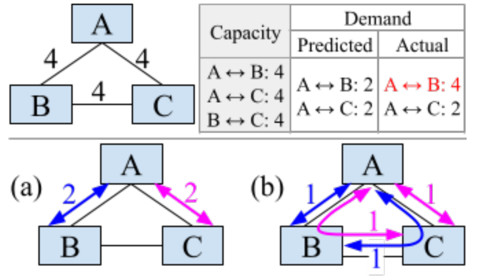

In this demonstration, we will be using [Gurobi](https://www.gurobi.com/).
Though it is a commercial solver, us students get free access --- follow the instructions on the website.
For the majority of the exercises here, the free version will be sufficient.

Finally, for learning more, there is a [large collection](https://www.gurobi.com/resources/demos) of Jupyter notebooks for practicing how to use the Gurobi optimizer.
There are many other tools too, for example the open source [HiGHS](https://github.com/ERGO-Code/HiGHS).
Related is constraint programming, for example Google OR-tools has [CP-SAT tutorial](https://github.com/d-krupke/cpsat-primer).

## Setup

First, let us install our the library we shall be using.

```{python}
#| output: false
%pip install -q gurobipy
import gurobipy as gp
from gurobipy import GRB
```

In addition, we will be using the following packages.
```{python}
#| output: false
%pip install -q numpy
%pip install -q matplotlib
%pip install -q networkx
%pip install -q igraph
import itertools
import numpy as np
import matplotlib.pyplot as plt
import networkx as nx
import igraph as ig
```

### Linear programs

The canonical form of a linear program (LP) is as follows:

$$
    \begin{align}
        \max_{x_1, \ldots, x_n} \qquad & \sum_{i=1}^n c_i x_i            \\
        \text{s.t.} \qquad             & \sum_{i=1}^n a_{1i} x_i \le b_1 \\
                                       & \qquad \vdots                   \\
                                       & \sum_{i=1}^n a_{mi} x_i \le b_m \\
                                       & x_1, \ldots, x_n \ge 0
    \end{align}
$$

We call $x_i$ the $n$ decision variables, as these are the variables that the solver decides what the values should be.
In LPs, the goal is to optimize for some linear objective function.
Then, we have $m + n$ constraints, including the ones restricting $x_i$ to be non-negative.

This is typically written more compactly using matrix form:

$$
    \begin{align}
        \max_{\vb{x} \in \R^n} \qquad & \vb{c}^T \vb{x}     \\
        \text{s.t.} \qquad            & A \vb{x} \le \vb{b} \\
                                      & \vb{x} \ge 0
    \end{align}
$$

### A simple model

Gurobi allows us to build models that are not necessarily in the canonical form as above.
Consider the following linear program with two variables.

$$
    \begin{align}
        \max_{x_1, x_2} \qquad & 3x_1 + 2x_2      \\
        \text{s.t.} \qquad     & 2x_1 + x_2 \le 4 \\
                               & x_1 + 2x_2 \le 4 \\
                               & x_1, x_2 \ge 0
    \end{align}
$$

Though solving this is straightforward using some algebra, we'll use it to illustrate the Gurobi API.
First, we need to create a model

```{python}
m = gp.Model("lp1")
```

and add the variables to the model

```{python}
x1 = m.addVar(vtype=GRB.CONTINUOUS)
x2 = m.addVar(vtype=GRB.CONTINUOUS)
```

and then we need to add the constraints,

```{python}
m.addConstr(2 * x1 + x2 <= 4, "c0")
m.addConstr(1 * x1 + 2 * x2 <= 4, "c1")
m.addConstr(x1 >= 0, "c2")
m.addConstr(x2 >= 0, "c3")
```

and also the objectives

```{python}
m.setObjective(3 * x1 + 2 * x2, GRB.MAXIMIZE)
```

Finally, we are ready to have Gurobi solve the optimization problem for us,

```{python}
m.optimize()
```

after which we can read the solution to be

$$
    x_1^* = \frac{4}{3},
    \qquad
    x_2^* = \frac{4}{3}
$$

```{python}
for v in m.getVars():
  print(f"{v.VarName} assigned to value {v.X}")
print(f"optimal value {m.ObjVal}")
```

#### References:

A comprehensive guide is available online <https://docs.gurobi.com/projects/optimizer/en/current/reference/>.

Model attributes:

- `m.Status` (2=Opt, 3=Infeasible, 5=Unbounded)
- `m.ObjVal` (total cost)

Variable attributes:

- `var.X` (the assigned value)
- `var.RC` (reduced cost)

Constraint attributes:

- `constr.Slack` (difference between LHS and RHS)
- `constr.Pi` (shadow price)

Important constants:

- `GRB.CONTINUOUS` (variable in reals)
- `GRB.BINARY` (0-1 variable)
- `GRB.MAXIMIZE` (maximization problem)
- `GRB.MINIMIZE` (minimization problem)


## Traffic Engineering

In Google's Jupiter datacenter, routers must quickly make decisions about where to route a packet.
This decision must be robust to bursty traffic, and effectively utilize the bandwidth of all links.
As such, over the past decade and a half, they've been employing linear optimization techniques.
We will formulate their model in Gurobi.

The datacenter interconnect can be thought of as a collection of nodes (switches/routers).
Between each pair of nodes is a direct link, and Google estimates a predicted amount of bandwidth that needs to be routed.
Rather than sending all packets down the direct link, sometimes a single in-direct hop is necessary for load balancing.
We do not allow multiple in-direct hops, as that would introduce significant latency.

- the nodes are $v_1, \ldots, v_\ell$.
- $C$ is a $\ell \times \ell$ capacity matrix, where $C_{ij}$ is the capacity of link from $v_i \to v_j$.
- $D$ is a $\ell \times \ell$ traffic matrix, where $D_{ij}$ is the demand needed to be sent from $v_i$ to $v_j$

Output a set of decision variables $x_p$, for every path $p: v_i \rightsquigarrow v_j$, the amount of packets that should flow from $i$ to $j$ along path $p$.
Minimize the max-link-utilization, given by the amount of packets flowing through over its capacity.

### A first Gurobi modeling

Hint: you may find [gp.quicksum](https://docs.gurobi.com/projects/optimizer/en/current/reference/python/func_global.html#quicksum) useful.

```{python}
type path = tuple[int, ...]

def all_paths(ell: int) -> list[path]:
  """Every path of one or two hops between distinct nodes."""
  nodes = range(ell)
  return list(itertools.permutations(nodes, 2)) + list(itertools.permutations(nodes, 3))

def traffic_engineer_1(ell: int, C: np.ndarray, D: np.ndarray) -> dict[path, float]:
  """
  Route the demand D over links of capacity C, both ell x ell matrices,
  along paths of at most two hops, minimizing the max-utilization.
  Returns the flow along every path.
  """
  m = gp.Model("te1")
  m.Params.OutputFlag = 0
  paths = all_paths(ell)

  # add the variables to optimize for

  # add all constraints

  # set the objective function and optimize

  # return the flow for each path
  raise NotImplementedError
```

Let's evaluate it on some simulated data.
We will have the bandwidths between each node follow a Poisson distribution, though studying the details is not important.

```{python}
#| code-fold: true
#| code-summary: "Simulation code"
# @title Simulation code { display-mode: "form" }
rng = np.random.default_rng(0)

ell = 12
i, j = np.indices((ell, ell))
C = 150 / np.maximum(np.abs(i - j), 1)

sizes = rng.lognormal(sigma=1.0, size=ell)
rates = 10 * np.outer(sizes, sizes)
np.fill_diagonal(rates, 0)

num_intervals, window = 50, 5
demand = rng.poisson(rates, size=(num_intervals, ell, ell))

# predictions[k] is the mean demand of windows[k], used to route windows[k + 1]
windows = demand.reshape(-1, window, ell, ell)
predictions = windows[:-1].mean(axis=1)
```

```{python}
#| code-fold: true
#| code-summary: "Evaluation code"
# @title Evaluation code { display-mode: "form" }
def path_fractions(flows: dict[path, float], D: np.ndarray) -> dict[path, float]:
  fractions = {}
  for p, f in flows.items():
    i, j = p[0], p[-1]
    if D[i, j] > 0:
      fractions[p] = f / D[i, j]
    else:
      fractions[p] = 1.0 if len(p) == 2 else 0.0
  return fractions

def link_load(fractions: dict[path, float], D: np.ndarray) -> np.ndarray:
  load = np.zeros(D.shape)
  for p, fraction in fractions.items():
    for u, v in itertools.pairwise(p):
      load[u, v] += fraction * D[p[0], p[-1]]
  return load

def max_utilization(load: np.ndarray, C: np.ndarray) -> float:
  return np.minimum(load / C, 1).max()

def dropped_load(load: np.ndarray, C: np.ndarray) -> float:
  return np.maximum(load - C, 0).sum()
```

```{python}
#| code-fold: true
#| code-summary: "Plot code"
# @title Plot code { display-mode: "form" }
utilization, best_utilization = [], []
dropped = 0
for prediction, intervals in zip(predictions, windows[1:]):
  fractions = path_fractions(traffic_engineer_1(ell, C, prediction), prediction)
  for D in intervals:
    load = link_load(fractions, D)
    utilization.append(max_utilization(load, C))
    dropped += dropped_load(load, C)

    best_fractions = path_fractions(traffic_engineer_1(ell, C, D), D)
    best_utilization.append(max_utilization(link_load(best_fractions, D), C))
percent_dropped_1 = 100 * dropped / windows[1:].sum()

t = np.arange(window, num_intervals)
plt.plot(t, utilization, label="traffic_engineer_1")
plt.plot(t, best_utilization, label="best possible")
plt.axhline(1, color="gray", linestyle="--")
plt.ylim(bottom=0.5)
plt.xlabel("interval")
plt.ylabel("max-utilization")
plt.legend()
plt.show()
```

### Dealing with bursty traffic

The issue here is that $D$ is not perfect!
It is only a prediction of the load.

Consider the example below, where the A-B link increased from a predicted demand $2$ to a real demand $4$.
Then (a) has 100\% link utilization, while (b) stays at 75\%.

{width=50% fig-align="center"}


Google's approach here is to introduce a spread parameter $S$.
Splitting commodities across multiple paths decreases the probability that multiple bursts will occur over the same link, and thus preventing bottlenecks.

```{python}
def min_capacity(C: np.ndarray, p: path) -> float:
  """The smallest capacity of a link along p."""
  return min(C[u, v] for u, v in itertools.pairwise(p))

def traffic_engineer_2(ell: int, S: float, C: np.ndarray, D: np.ndarray) -> dict[path, float]:
  """
  As traffic_engineer_1, with the spread parameter S in (0, 1]:
  no path carries more than 1/S times its share of its commodity's demand,
  where the shares are proportional to each path's smallest link capacity.
  Returns the flow along every path.
  """
  m = gp.Model("te2")
  m.Params.OutputFlag = 0
  paths = all_paths(ell)

  # add the objective variables

  # add the constraints

  # set the objective and optimize

  # return the flow for each path
  raise NotImplementedError
```

```{python}
#| code-fold: true
#| code-summary: "Plot code"
# @title Plot code { display-mode: "form" }
Ss = 1 / np.arange(ell - 1, 0, -1)
percent_dropped = []
for S in Ss:
  dropped = 0
  for prediction, intervals in zip(predictions, windows[1:]):
    fractions = path_fractions(traffic_engineer_2(ell, S, C, prediction), prediction)
    for D in intervals:
      dropped += dropped_load(link_load(fractions, D), C)
  percent_dropped.append(100 * dropped / windows[1:].sum())

plt.plot([0, *Ss], [percent_dropped_1, *percent_dropped], marker="o")
plt.xlabel("$S$")
plt.ylabel("traffic dropped (%)")
plt.yscale("symlog", linthresh=1e-3)
plt.show()
```

## Branch and Bound

Many problems, e.g. vertex cover as we will see later, require integer decision variables.
This is a much more powerful problem known as an integer program.
In this section, we will implement a solver by reducing it to many cases of linear programs.

First, we will simplify it to only consider binary decision variables.
This is because in general, integer variables can be encoded in binary.

Then, the naive approach here is to DFS / recursively-backtrack down the space of all binary assignments.
Branch-and-bound is a technique that whenever it finds a feasible solution, bounds the solution value.
Then, it checks if the branch is worth considering by whether the LP falls on the side of the bound.

Hint: remember to check the status code of the model after optimizing!

```{python}
def is_integral(value: float) -> bool:
  return abs(value - round(value)) < 1e-6

def enforce_value(var: gp.Var, val: float):
  var.LB = val
  var.UB = val

def branch_and_bound(
  m: gp.Model, x: list[gp.Var], L: float, U: float, best: list[float] | None
) -> tuple[float, list[float] | None]:
  """
  Given model m, relaxed variables x, L/U lower/upper bounds, and the incumbent solution best.
  Update U and best if this branch has a better integer solution.
  """

  # prune this branch based on L and U

  # solve the LP relaxation

  # update the lower bound for the subtree

  # stop if solution is integral

  # otherwise branch on a fractional variable
  raise NotImplementedError

def solve(m: gp.Model) -> tuple[float, list[float]] | None:
  """
  Minimize the integer program m via branch-and-bound.
  Returns optimal value U, and the optimal integer solution x,
  or None if m is infeasible.
  """
  m.update()
  x = [v for v in m.getVars() if v.VType == GRB.BINARY]
  for v in x:
    v.VType = GRB.CONTINUOUS
  m.Params.OutputFlag = 0
  U, best = branch_and_bound(m, x, float("-inf"), float("inf"), None)
  if best is None:
    return None
  return U, best
```

Now that we have a (presumably) working integer solver, let's test it out.
We will find the minimum vertex cover for an undirected graph $G$.

```{python}
def vertex_cover(G: nx.Graph) -> gp.Model:
  """The integer program for a minimum vertex cover of G."""
  m = gp.Model("vertex_cover")
  x = {v: m.addVar(vtype=GRB.BINARY) for v in G.nodes}
  for u, v in G.edges:
    m.addConstr(x[u] + x[v] >= 1)
  m.setObjective(gp.quicksum(x[v] for v in G.nodes), GRB.MINIMIZE)
  return m
```

Plotting it, we find a solution value of 6, which is optimal (exercise: why).

```{python}
#| code-fold: true
#| code-summary: "Graph code"
# @title Graph code { display-mode: "form" }
n, p = 10, 0.3
G = nx.erdos_renyi_graph(n, p, seed=1)
pos = nx.spring_layout(G, seed=0)
```

```{python}
#| code-fold: true
#| code-summary: "Plot code"
# @title Plot code { display-mode: "form" }
U, best = solve(vertex_cover(G))
cover = [v for v in G.nodes if round(best[v]) == 1]
colors = ["orange" if v in cover else "lightgray" for v in G.nodes]

fig, (ax1, ax2) = plt.subplots(1, 2, figsize=(7, 3))
nx.draw(G, pos, ax=ax1, with_labels=True)
nx.draw(G, pos, ax=ax2, with_labels=True, node_color=colors)
plt.show()
```

## Traveling Salesman

### MTZ formulation

We tour the capitals of the 48 contiguous US states, using the data from Gurobi's [TSP example](https://github.com/Gurobi/modeling-examples/tree/master/traveling_salesman).

::: {.callout-note}
On the free Gurobi license, models are limited to 2000 variables and 2000 constraints.
The models below have $n^2$ arc variables (plus $n$ MTZ variables), so keep at most 44 states, e.g. with `states = states[:44]`.
:::

```{python}
#| code-fold: true
#| code-summary: "Capitals data"
# @title Capitals data { display-mode: "form" }
import json
import urllib.request

url = "https://raw.githubusercontent.com/Gurobi/modeling-examples/master/traveling_salesman/capitals.json"
capitals = json.loads(urllib.request.urlopen(url).read())
states = [s for s in capitals if s not in ["AK", "HI"]]
coordinates = np.array([[float(capitals[s]["long"]), float(capitals[s]["lat"])] for s in states])

n = len(states)
V = range(n)              # cities 0,...,n-1
c = np.linalg.norm(coordinates[:, None] - coordinates[None, :], axis=2)
```

Now, we will model the TSP problem, using decision variables for each edge.
We have two types of constrants: degree and subtour elimination:

$$
    \begin{align}
        \min_{\vb{x}, \vb{y}} \qquad & \sum_{e \in E} w_e x_e                                               \\
        \text{s.t.} \qquad           & \sum_{u \in N^-(v)} x_{u \to v} = 1                                  \\
                                     & \sum_{u \in N^+(v)} x_{v \to u} = 1                                  \\
                                     & y_v - y_u - 1 \ge - n (1 - x_{u \to v}) \qquad \forall u \to v \in E
    \end{align}
$$

where for MTZ subtour elimination, when $x_{u \to v} = 1$ then we require $y_v - y_u \ge 1$.
Otherwise if $x_{u \to v} = 0$, then the the constraint will never be active.

```{python}
m = gp.Model("TSP_MTZ")
m.Params.OutputFlag = 0
x = m.addVars(V, V, vtype=gp.GRB.BINARY, name="x")
u = m.addVars(V, lb=1, ub=n, name="u")

# Objective
## TODO

# Degree constraints
## TODO

# MTZ subtour elimination constraints
## TODO

m.optimize()
```

For the US capitals graph $V$ with costs $c$, this takes quite a bit of time, though it is indeed an achievement it completes at all!
Let's see how we can do better.

### Lazy constraints

The issue with the previous approach is that the LP relaxations have a large integrality gap.
That is, during branch-and-bound, the LP typically produces a value much smaller than any integer tour can have, so low that almost nothing can be pruned and it amounts to performing a brute-force search.
Thus, what we need is to constrain the LP further (in a way that does not change integer solutions).

The DFJ approach does not use the monotone increasing ordering variables.
Instead, it checks whether there is a connected component of size $< n$.
In particular, whether there exists a subset $S \subsetneq V$ that is separarated from the rest of the graph (i.e. no connecting edges).
Adding such *subtour elimination* constraints, then

- any tour is still feasible
- any tour with subtours are eliminated
- some fractional solutions become invalid

where the first two are necessary for correctness, and the third for a performance bound.
This general technique is known as strengthening the formulation.
Note however that solving the LP will more constraints typically takes longer, and thus a balance is needed.

In principle, the LP relaxation we will thus solve is

$$
    \begin{align}
        \min_{\vb{x}} \qquad & \sum_{e \in E} w_e x_e                                                                                \\
        \text{s.t.} \qquad   & \sum_{u \in N^-(v)} x_{u \to v} = 1                                                                   \\
                             & \sum_{u \in N^+(v)} x_{v \to u} = 1                                                                   \\
                             & \sum_{u \in S} \sum_{v \notin S} x_{u \to v} \ge 1 \qquad \forall \emptyset \subsetneq S \subsetneq V \\
                             & 0 \le x_e \le 1
    \end{align}
$$

Indeed, in this case, there are an exponential number of constraints to be added!
Clearly we cannot even build the model in a reasonable amount of time.

Gurobi `cbLazy` is the tool towards this, standing for a lazy *callback*.
Start with a subset of constraints.
Whenever the Gurobi solver proposes a candidate integral solution, such a callback is called.
Only then do we make sure that any constraints that should apply, actually do apply.

In this case, to check whether there exists a subtour, we can simply check for a non-trivial connected components!
If so, then we prevent the model from accepting the tour, and instead add constraints to the model.
Gurobi will then continue its branch-and-bound loop.

```{python}
def find_subtours(n, xsol):
  """Given integer solution (all 0.0 or 1.0), return list of subtour node sets."""
  G = nx.DiGraph()
  G.add_nodes_from(range(n))

  for i in range(n):
    for j in range(n):
      if i != j and int(round(xsol[i, j]))==1:       # round 1.0 to 1 and 0.0 to 0
        G.add_edge(i, j)

  components = list(nx.strongly_connected_components(G))

  # A subtour is any component smaller than n
  return [S for S in components if len(S) < n]
```

Hints: the `cbGetSolution` and `cbLazy` functions will be useful. Remember to check for `MIPSOL`.

```{python}
def callback(model, where):
  if where == GRB.Callback.MIPSOL: # Only for integer solutions
    x = model._x
    n = model._n

    # 1. Read the integer solution
    ## TODO

    # 2. Find subtours
    ## TODO

    # 3. For each subtour, add a lazy constraint
    ## TODO
```

Then, once this callback is created, it is passed into the `optimize` function.
Notice that the model parameters must set `LazyConstraints = 1`.

```{python}
m = gp.Model("TSP_lazy_only")
m.Params.OutputFlag = 0
x = m.addVars(V, V, vtype=GRB.BINARY, name="x")
for i in V:
  x[i,i].ub = 0   # no self-loops

# Objective
m.setObjective(
  gp.quicksum(c[i,j]*x[i,j] for i, j in itertools.permutations(V, 2)),
  GRB.MINIMIZE)

# Degree constraints
for i in V:
  m.addConstr(gp.quicksum(x[i,j] for j in V if j != i) == 1)
  m.addConstr(gp.quicksum(x[j,i] for j in V if j != i) == 1)

m.Params.LazyConstraints = 1   # REQUIRED: tells Gurobi to expect cbLazy

m._x = x    # attach variables so callback can access them
m._n = n
m.optimize(callback)
```

The second part of the DFJ formulation is to apply this to the fractional solutions too.
Indeed, now we need to be able to detect violations of our constraint given a fractional tour.
Observe that we simply need to consider the subset that is the most isolated, i.e. with the minimum cut.
The following code does this using the `iGraph` library (as `networkx` does not have a function for this).

```{python}
def mincut_separate_dfj(n, xstar):
  """
  Find the most violated DFJ constraint in a fractional solution.
  Returns (S, cut_value) if violated, else (None, None).
  """
  edges = [(i, j) for i in range(n) for j in range(n) if i != j]
  caps = [float(xstar[i, j]) for (i, j) in edges]

  g = ig.Graph(n=n, edges=edges, directed=True)
  g.es["cap"] = caps

  cut = g.mincut(capacity="cap")      # global directed min-cut
  val = float(cut.value)

  if val < 1 - 1e-6:    # tolerance for numerical safety
    A, B = cut.partition
    S = set(A) if 0 < len(A) < n else set(B)
    if 0 < len(S) < n:
      return S, val
  return None, None
```

Finally, back to the call-back, we (optionally, for performance) will extend the callback to also run on fractional solutions.

```{python}
def callback(model, where):
  x, n = model._x, model._n

  # (A) CORRECTNESS: reject integer solutions with subtours
  if where == GRB.Callback.MIPSOL:
    ## TODO
    raise NotImplementedError

  # (B) PERFORMANCE: tighten LP relaxation with DFJ cuts
  if where == GRB.Callback.MIPNODE:
    ## TODO
    raise NotImplementedError
```

Putting this back into the solver, we get the branch-and-cut algorithm applied to the TSP.

```{python}
m2 = gp.Model("TSP_branch_and_cut")
m2.Params.OutputFlag = 0
x = m2.addVars(V, V, vtype=GRB.BINARY, name="x")
for i in V:
  x[i,i].ub = 0   # no self-loops

# Objective
m2.setObjective(
  gp.quicksum(c[i,j]*x[i,j] for i, j in itertools.permutations(V, 2)),
  GRB.MINIMIZE)

# Degree constraints
for i in V:
  m2.addConstr(gp.quicksum(x[i,j] for j in V if j != i) == 1)
  m2.addConstr(gp.quicksum(x[j,i] for j in V if j != i) == 1)

m2.Params.LazyConstraints = 1   # required for cbLazy
m2._x = x
m2._n = n
m2.optimize(callback)
```
